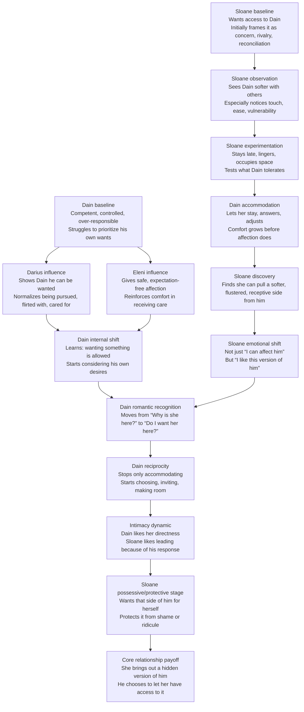

Yes. Here’s a **clean plotting graph** with only the key beats.

## Relationship Development Graph

---

## Super Short Character Function Notes

### Dain
- **Core issue:** Knows how to be needed, not how to simply be wanted.
- **Arc:** From responsibility and self-denial to chosen desire.
- **Romantic key:** Learns he likes being pursued, affected, and allowed to soften.

### Sloane
- **Core issue:** Wants access before she understands why she wants it.
- **Arc:** From jealousy/curiosity to genuine desire and emotional protectiveness.
- **Romantic key:** Likes leading because it reveals a version of Dain no one else gets in the same way.

### Darius
- **Function:** Opens Dain to the idea that he can want things.
- **Effect on plot:** Indirectly teaches Dain to consider his own happiness.

### Eleni
- **Function:** Reinforces that care can be received without being earned.
- **Effect on plot:** Helps Dain relax into comfort and affection.

---

## Simple Stage List for Plotting

1. **Dain only feels responsible for Sloane**
2. **Sloane starts watching him closely**
3. **She notices his softness with others**
4. **She begins lingering and pushing presence, not touch**
5. **Dain gets used to her being there**
6. **Sloane discovers she can fluster him**
7. **She likes the version of him she brings out**
8. **Dain starts asking what *he* wants**
9. **He realizes he wants her around**
10. **He begins reciprocating**
11. **Their intimacy dynamic forms**
12. **Sloane becomes protective and possessive of his softness**

---

## One-Line Core Dynamic

**Darius and Eleni teach Dain he is allowed to receive affection; Sloane becomes the person who makes him want it.**

If you want, I can also turn this into a **2-axis graph** like:
- **emotional intimacy over time**
- **physical comfort over time**
for easier chapter-by-chapter plotting.